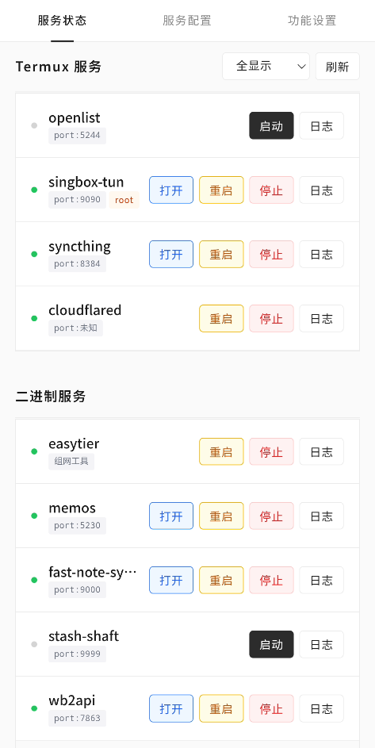
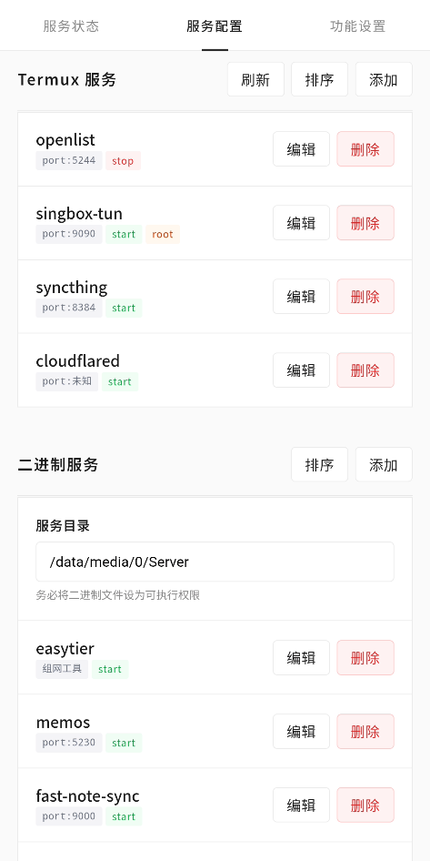
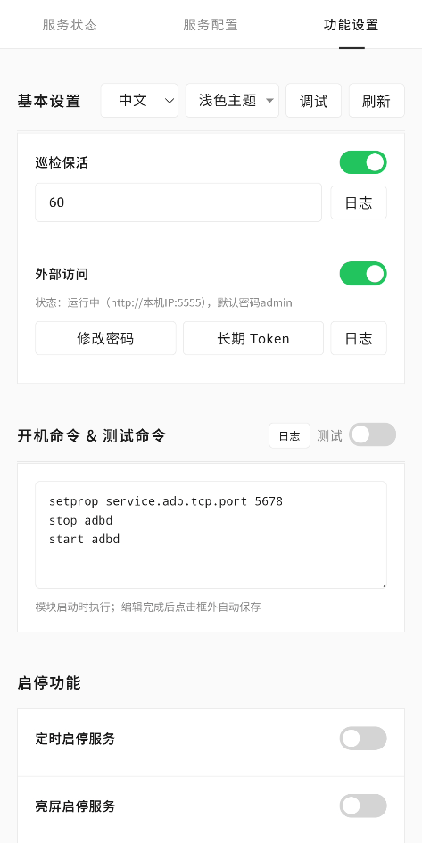
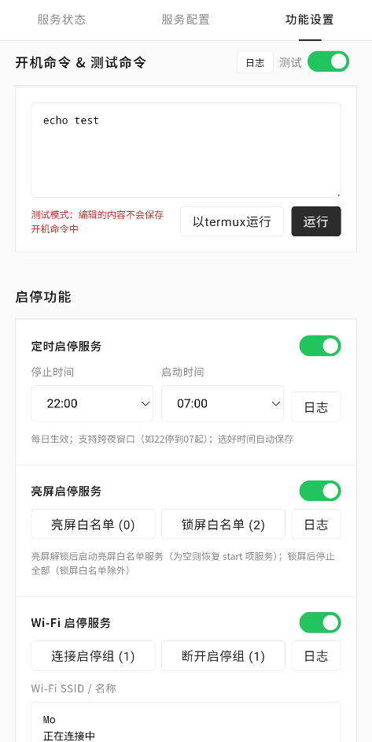
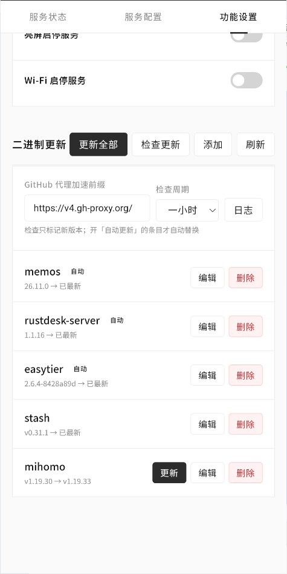
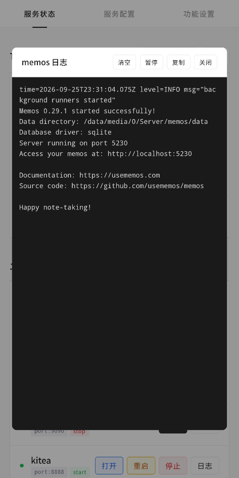

<h1>SvcHub</h1>
  <a href="./README.md">中文</a> | <a href="./README.en.md">English</a>

  

    <b>A Termux/binary service start and keeplive and update management module, support a variety of start and stop policies, WebUI aggregation management</b>
  

  

    
    
    
    
    
    
    
  

  

    Online docs: <a href="https://limpidmo.github.io/SvcHub">limpidmo.github.io/SvcHub<a>
  

  

    <b>Built to aggregate and manage services, so you don't need a separate module for each. If you find it useful, please give the repo a Star ⭐~</b>
  

## Screenshots

| Service Status | Service Config | Settings |
|---------|---------|---------|
|  |  ||
| Start/Stop Features | Binary Update | Service Logs |
|  |  ||

## Core Features

- **WebUI**: bilingual (Chinese/English) interface for unified start/stop, configuration management, service logs and resource usage; browser access supports PWA installation
- **Two service types**: startup configuration and cleanup-command management for **Termux services** and **binary services**. Termux services run without keeping the app in the background and can run as root
- **Multiple start/stop strategies**: scheduled window start/stop, screen on/off start/stop, Wi-Fi start/stop and more, to meet diverse scheduling needs
- **Patrol keep-alive**: patrols every 60 seconds by default (configurable 10~86400 seconds), automatically revives services tagged `start`, and rotates logs automatically
- **Update service**: binary updates from GitHub repositories, version checks every hour/day/week, optional automatic updates, automatic rollback if replacement fails

>Tips: This module does not open the wake-up lock by default. If you need to reduce the impact of lock screen Doze or CPU sleep on the inspection and update check, you can open the wake-up lock in the "Basic Settings"

## Getting Started

1. Download the module ZIP from [Releases](https://github.com/LimpidMo/SvcHub/releases/)
2. In your root manager → Modules → Install from local storage, flash the ZIP; volume keys offer an optional DNS resolve mount (skipped by default)
3. Reboot after installation; existing configuration is preserved on upgrade
4. In KernelSU or APatch manager → Modules → open SvcHub → enter the WebUI

> Magisk users have no manager WebUI access. The default setting for the first installation is to enable external access; accessing via the browser, go to `http://127.0.0.1:5555`, with the default password `admin`. A mandatory password change is required upon the first login. KernelSU/APatch default-disable external access. After changing the password, it is enabled within the manager.

## Notes

- Verify the safety of services and commands yourself before adding them to the module; you are responsible for your own actions and their results
- Termux services require the installed Termux app with the matching package installed via `pkg install`; download binaries for binary services from trusted sources only, and make them executable (`chmod +x`) yourself
- All scripts are POSIX sh, compatible with Android `/system/bin/sh`
- Modding has risks — back up your data. The code is fully public; review it before flashing

## Documentation

Full user guide and development docs: [https://limpidmo.github.io/SvcHub](https://limpidmo.github.io/SvcHub).

- [Docs Home](https://limpidmo.github.io/SvcHub/en/) — feature overview and docs entry

**Guide**

- [Introduction](https://limpidmo.github.io/SvcHub/en/guide/) — module scope and core concepts
- [Start/Stop Services](https://limpidmo.github.io/SvcHub/en/guide/features) — schedule / screen / Wi-Fi control and priority
- [Patrol Keep-alive](https://limpidmo.github.io/SvcHub/en/guide/keepalive) — patrol interval and service keep-alive
- [Service Examples](https://limpidmo.github.io/SvcHub/en/guide/examples) — Termux and binary service examples
- [Termux Service](https://limpidmo.github.io/SvcHub/en/guide/termux) · [Binary Service](https://limpidmo.github.io/SvcHub/en/guide/binary) — configuration reference
- [Notes](https://limpidmo.github.io/SvcHub/en/guide/notes) · [FAQ](https://limpidmo.github.io/SvcHub/en/guide/faq) — usage notes and troubleshooting
- [Changelog](https://limpidmo.github.io/SvcHub/guide/changelog) — release history

**Development**

- [Local Development](https://limpidmo.github.io/SvcHub/en/dev/) — run real scripts in a PC sandbox
- [Module Build](https://limpidmo.github.io/SvcHub/en/dev/build) — packaging and validation

## License

[GNU General Public License v3.0](https://www.gnu.org/licenses/gpl-3.0.html) · See [LICENSE](LICENSE) for the full text

Copyright (C) 2026 LimpidMo
