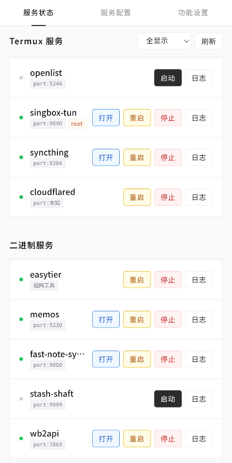
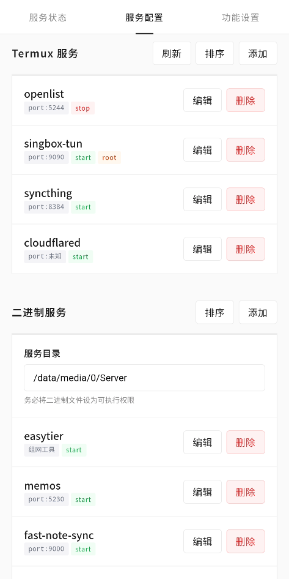
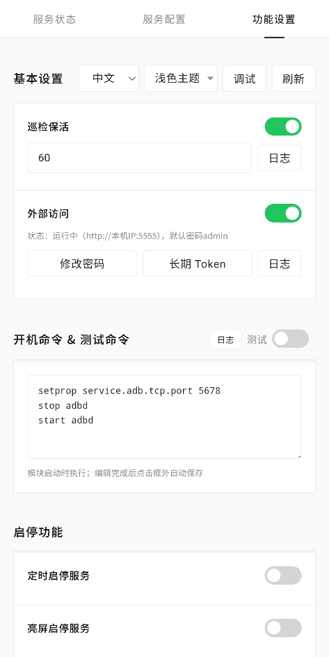
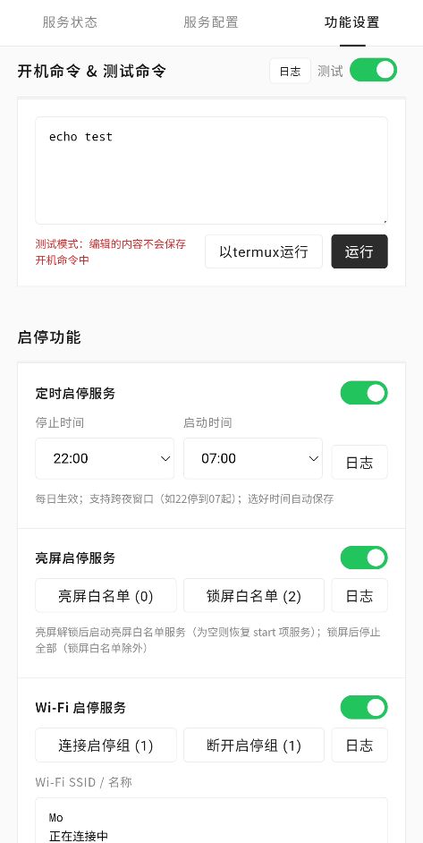
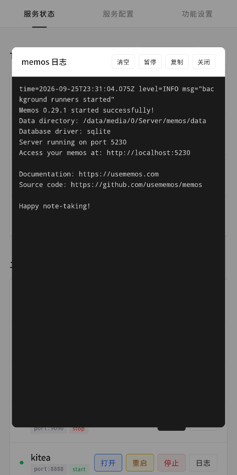
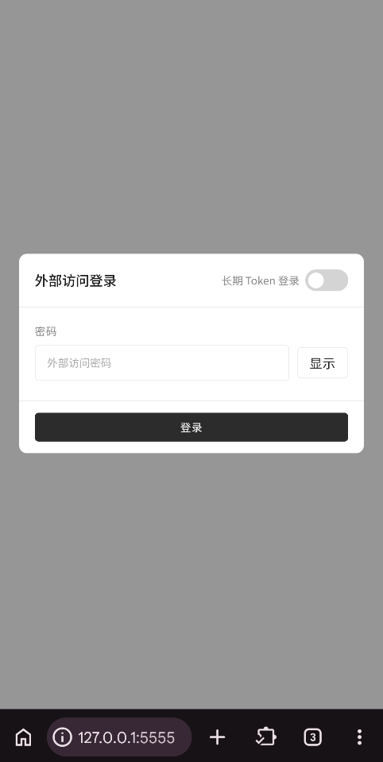

<h1>SvcHub</h1>
  <a href="./README.md">中文</a> | <a href="./README.en.md">English</a>

  

    <b>A Termux/binary service start and keeplive management module, support a variety of start and stop policies, WebUI aggregation management</b>
  

  

    
    
    
    
    
    
    
  

  

    Online docs: <a href="https://limpidmo.github.io/SvcHub">limpidmo.github.io/SvcHub<a>
  

  

    <b>Built to aggregate and manage services, so you don't need a separate module for each. If you find it useful, please give the repo a Star ⭐~</b>
  

## Screenshots

| Service Status | Service Config | Settings |
|---------|---------|---------|
|  |  ||
| Start/Stop Features | Service Logs | Web Login |
|  |  ||

## Core Features

- **Two Service Types**: Manage startup and cleanup commands for **Termux services** and **binary services**. Termux services run without the app in the background and can optionally run as root.
- **Multiple start/stop strategies**: scheduled stop window, screen on/off control, Wi-Fi based start/stop and more, to meet diverse scheduling needs
- **Patrol keep-alive**: patrols every 60 seconds by default (configurable 10~84600), automatically revives services tagged `start`, and rotates logs automatically.
- **WebUI**: Chinese/English bilingual, with one interface for service start/stop, configuration and log viewing. Supports both the in-manager WebUI and direct browser access, plus PWA installation

## Getting Started

1. Download the module ZIP from [Releases](https://github.com/LimpidMo/SvcHub/releases/)
2. In your root manager → Modules → Install from local storage, flash the ZIP; volume keys offer an optional DNS resolve mount (skipped by default)
3. Reboot after installation; existing configuration is preserved on upgrade
4. In KernelSU or APatch manager → Modules → open SvcHub → enter the WebUI
   > Magisk users have no in-manager WebUI entry. With external access enabled (on by default), visit `http://127.0.0.1:5555` in a browser; default password is `admin`

## Notes

- Verify the safety of services and commands yourself before adding them to the module; you are responsible for your own actions and their results
- Termux services require the installed Termux app with the matching package installed via `pkg install`; download binaries for binary services from trusted sources only, and make them executable (`chmod +x`) yourself
- All scripts are POSIX sh, compatible with Android `/system/bin/sh`
- Modding has risks — back up your data. The code is fully public; review it before flashing

## License

[GNU General Public License v3.0](https://www.gnu.org/licenses/gpl-3.0.html) · See [LICENSE](LICENSE) for the full text

Copyright (C) 2026 LimpidMo
